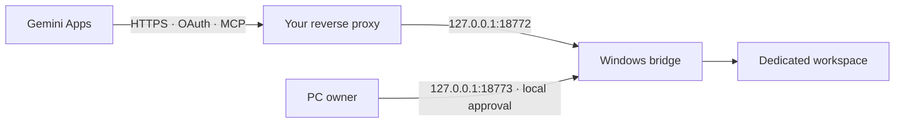

# GeminiRDC

[简体中文](README.zh-CN.md) · [Security model](SECURITY.md)

GeminiRDC is a self-hosted MCP server that connects Gemini Apps to a Windows PC. It can read hardware information, list processes, and work with a dedicated folder. File changes, PowerShell commands, and screenshots run only after the PC owner approves the specific request on Windows.

**Preview status.** I verified a live hardware query in Gemini chat, plus file reads and a PowerShell request in Gemini Apps Developer Mode. The MCP smoke test also verifies file writes, command output, and denial of a screenshot request. In the expanded workspace tests, standard Gemini chat discovered the tools but did not dispatch the file read. Start in Developer Mode. Live screenshot rendering in Gemini has yet to be verified.



| Available after OAuth linking | Requires an additional local approval |
| --- | --- |
| PC hardware and connection checks | Write, move, and create directories inside the workspace |
| List directories, inspect metadata, read UTF-8 files, search text | Run a PowerShell command as the Windows user running the bridge |
| List process names and IDs, retrieve an approved action's result | Capture a still image of the primary display |

## Quick start

Use Windows with Python 3.10 or newer and Windows PowerShell. Start the bridge as your normal Windows user. The Gemini web account also needs access to custom connected apps. Eligibility depends on the account, location, language, and history settings. [Google's eligibility and connection instructions](https://support.google.com/gemini/answer/17209137)

### 1. Install and verify locally

```powershell
git clone https://github.com/solongrey9-code/geminirdc.git
Set-Location geminirdc
python -m venv .venv
.\.venv\Scripts\python.exe -m pip install -r requirements.txt
.\.venv\Scripts\python.exe verify.py
```

The last command starts a read-only stdio server for the check and prints live hardware information.

### 2. Start the bridge and configure HTTPS

Substitute the origin of an HTTPS reverse proxy that can reach your Windows PC. The launch script creates `workspace\` on first run. To select an existing directory, pass `-Workspace 'D:\GeminiShare'`.

```powershell
$origin = 'https://bridge.example.com'
.\start-workspace.ps1 -Origin $origin
```

Forward these paths to `http://127.0.0.1:18772`, preserving the request path and public host.

| Public path | Purpose |
| --- | --- |
| `/gemini-pc` and its subpaths | MCP, OAuth, and the one-time pairing page |
| `/.well-known/oauth-authorization-server/gemini-pc` | OAuth issuer metadata |
| `/.well-known/oauth-protected-resource/gemini-pc/mcp` | OAuth resource metadata |

If you use an existing Tailscale Funnel, the following commands mount only those routes. Use the HTTPS origin displayed by Funnel for the bridge's `-Origin`. [Tailscale Funnel documentation](https://tailscale.com/docs/reference/tailscale-cli/funnel)

```powershell
$routes = @(
    '/gemini-pc',
    '/.well-known/oauth-authorization-server/gemini-pc',
    '/.well-known/oauth-protected-resource/gemini-pc/mcp'
)
foreach ($route in $routes) {
    tailscale funnel --bg --https=443 "--set-path=$route" "http://127.0.0.1:18772$route"
}
```

Keep port `18773` on this PC. It serves the [local approval page](http://127.0.0.1:18773/review).

### 3. Pair Gemini and try a read

1. In a second PowerShell window, run `.\pair-workspace.ps1 -Open`. New pairing requests are accepted for 15 minutes.
2. Open [Gemini Apps Developer Mode](https://gemini.google.com/devmode), choose **Create new**, and enter `https://bridge.example.com/gemini-pc/mcp` using your own origin.
3. Continue through Google's consent screen. On the bridge's pairing page, copy the request ID. Run `.\pair-workspace.ps1 -Approve '<request-id>'` on the PC, then select **Finish linking** in the browser.
4. Save **GeminiRDC** after Gemini shows the available tools. Run `.\pair-workspace.ps1 -Close` to close enrollment and keep the existing link.
5. With GeminiRDC selected, ask it to run `get_windows_hardware`. To try a file read, create `workspace\hello.txt` and ask Gemini to read it with `read_file`.

For a write, command, or screenshot, Gemini returns an action ID. Review the exact operation in the local approval page. After it runs, view the output there or ask Gemini to retrieve it with `get_action_result`. [Google's Developer Mode guide](https://developers.google.com/connected-apps/mcp/dev-mode/usage)

## Verify the connected server

With a disposable local instance and working directory, run the verification script in a second PowerShell window. This exercises OAuth and the tools without making a request to Google.

```powershell
.\pair-workspace.ps1 -Open
.\.venv\Scripts\python.exe verify_connected.py --local-workspace workspace
.\pair-workspace.ps1 -Close
```

The bridge runs while its terminal is open. Restart it with the same origin and Windows user to reuse the encrypted OAuth state. To remove a link, disconnect it in Gemini. For local revocation of every link, stop the bridge and remove its own `.bridge\oauth.dpapi` file before restarting.

Released under the [MIT License](LICENSE). This is an independent project for Gemini Apps.
